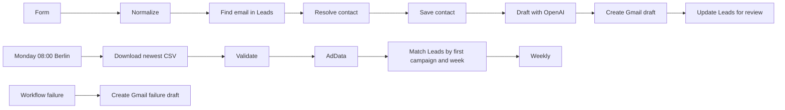

# Lead capture, Gmail reply drafts and campaign reporting

An n8n form saves a contact in the Leads Google Sheet. OpenAI classifies the enquiry and writes a proposed subject and reply. Gmail creates a draft for human review. A weekly workflow imports ad metrics from Google Drive and calculates cost per captured lead.

## Run locally

1. From the repository folder, run `docker compose up -d`. The supplied Compose file uses a fresh volume. If the existing local container already owns port 5678, use that instance for practice. Open http://localhost:5678.
2. Create Leads, AdData and Weekly tabs with the corresponding header CSVs in examples. Format Weekly CTR as a percentage and spend and CPL as EUR.
3. Import the four JSON files under workflows. Select your Sheets, Drive, Gmail and OpenAI credentials in the relevant nodes. Substitute your spreadsheet ID, Drive folder ID and error-draft recipient. Select an available OpenAI model.
4. Select the imported failure workflow under Settings → Error Workflow on the lead, report and optional upload flows. Publish after configuration. The templates omit installation-specific IDs.
5. Open the lead form using a link ending in `?utm_source=demo&utm_campaign=DEMO_phase3`. Review the reply in Gmail Drafts and its copy in Leads.
6. Put a normalized weekly EUR CSV in the configured Drive folder. Execute the weekly workflow or leave n8n running Monday at 08:00 Berlin. See [reporting](docs/PHASE3.md).

## Verification

Live tests on 4 November 2026 exercised 12 form submissions with duplicates, blank text, spam, pricing, support and multilingual input. An additional controlled OpenAI failure preserved the lead and created a failure draft. The demo report produced 5% CTR and €40 CPL for one campaign and “no leads” for the other.

See [screenshots](docs/SCREENSHOTS.md), [test evidence and limits](docs/PLAN-COMPARISON.md) and [publishing steps](docs/PUBLISHING.md). Offline checks run with `python -m unittest discover -s tests -v` and `node --test tests/report.test.js`.

